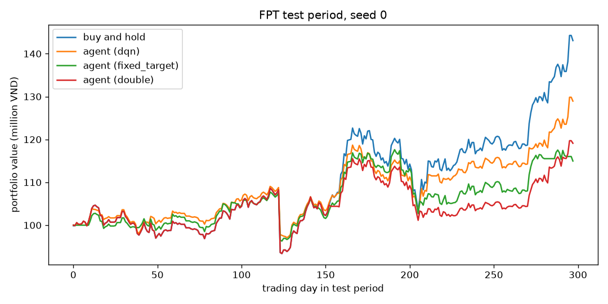
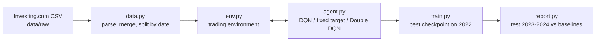

# DQNStockTrader

[](https://github.com/doanan293/DQNStockTrader/actions/workflows/ci.yml)

Deep Q-learning agents (DQN, fixed-target DQN and Double DQN, in PyTorch) that trade ten large Vietnamese stocks with realistic lot sizes, fees and sales tax, evaluated against buy-and-hold and a random agent.

## Results

Agents train on 2014–2021, pick their checkpoint on 2022 and are tested once on January 2023 to 15 March 2024. Every agent run uses three seeds. The table shows test-period returns for Double DQN against the two baselines (mean ± standard deviation over seeds, full table in [results/summary.md](results/summary.md)):

| ticker | buy and hold | random | Double DQN | drawdown, buy and hold | drawdown, Double DQN |
|---|---|---|---|---|---|
| ACB | 20.0% | -3.6% ± 4.5% | 14.1% ± 10.0% | -19.5% | -16.3% |
| ACV | 5.4% | -9.8% ± 4.6% | -7.4% ± 2.6% | -26.5% | -25.2% |
| BID | 26.4% | 6.7% ± 6.7% | 10.9% ± 7.1% | -20.7% | -14.5% |
| CTG | 23.7% | 4.5% ± 5.1% | 5.3% ± 8.8% | -21.2% | -13.1% |
| FPT | 43.3% | 7.4% ± 4.3% | 21.9% ± 6.1% | -15.7% | -14.2% |
| GAS | -20.5% | -28.2% ± 4.8% | -21.6% ± 2.8% | -30.4% | -29.1% |
| HPG | 55.4% | 5.6% ± 16.7% | 25.3% ± 12.0% | -21.1% | -16.4% |
| VCB | 13.7% | -3.1% ± 20.1% | -0.4% ± 3.4% | -24.5% | -22.4% |
| VHM | -14.0% | -21.6% ± 6.5% | -4.4% ± 16.6% | -38.6% | -24.7% |
| VIC | -21.1% | -25.9% ± 3.2% | -9.6% ± 10.1% | -45.4% | -31.8% |

Double DQN beat the random agent on all ten stocks and had a smaller maximum drawdown than buy-and-hold on all ten. It earned more than buy-and-hold only on VHM and VIC, the two stocks that fell during the test period. In a rising market the agent spends part of its time in cash, so it gives up much of the gain.

On FPT the three variants are close. Double DQN has the lowest spread across seeds:

| variant | return | Sharpe | max drawdown | trades |
|---|---|---|---|---|
| dqn | 21.3% ± 10.3% | 1.02 | -13.6% | 31 |
| fixed_target | 14.8% ± 13.2% | 0.67 | -13.9% | 47 |
| double | 21.9% ± 6.1% | 0.94 | -14.2% | 21 |



The original project reported +8.16 % on FPT for January to August 2023 and compared it with nothing. This version adds the baselines, which show that a positive return alone says little in a rising market.

## How it works



- State: the last 10 daily price changes squashed to [0, 1] with a sigmoid, plus the share of the maximum position currently held.
- Actions: hold, buy 300, 600 or 900 shares, or sell everything. A buy the cash cannot cover does nothing.
- Costs: 0.15 % fee on every order and 0.1 % tax on sales. Starting cash is 100 million VND.
- Reward: the change in portfolio value after costs (mark to market). The original reward, paid only when selling, is still available as `reward_mode: realized`.
- Q-network: the original architecture ported to PyTorch, Conv1D(64, 6) → Dropout → Conv1D(32, 3) → Conv1D(16, 2) → MaxPool → Dense(32) → Dense(5), trained with Huber loss and Adam from a replay buffer.

## Quickstart

```bash
uv sync
uv run dqn-trader train FPT --variant double --seed 0     # about 6 minutes on a laptop CPU
uv run dqn-trader evaluate FPT checkpoints/FPT_double_s0.pt  # test-period return, Sharpe, drawdown
uv run dqn-trader report                                   # full grid of 36 agents, 1-2 hours
```

Settings, including the date splits, tickers and hyperparameters, are in [configs/default.yaml](configs/default.yaml).

## Data

[data/raw](data/raw) holds daily prices for ACB, ACV, BID, CTG, FPT, GAS, HPG, VCB, VHM and VIC, merged from Investing.com exports (about 1 MB in total). Column definitions and date ranges are in [data/README.md](data/README.md).

## Limitations

- One test period of 14 months, mostly a rising market. The ranking could change in another period.
- Three seeds per configuration. Seed-to-seed spread is often as large as the gap to a baseline.
- Close prices only. There is no slippage, no price limit, and orders always fill at the close.
- This is a research project. Nothing here is investment advice.

## Based on pskrunner14/trading-bot

The first version was a fork of [pskrunner14/trading-bot](https://github.com/pskrunner14/trading-bot) (MIT, © 2018 Prabhsimran Singh). This rewrite keeps its idea of a windowed price state and the DQN variants, and changes the rest:

- Keras 2 and TensorFlow 1 replaced with PyTorch, which runs on current Python.
- Lot-based buying, cash limits, fees and taxes added to the environment.
- Fixed bugs: the target network never synchronized, evaluation wrote into the replay buffer, the state was squeezed into [0, 0.01], and the window size was hard-coded.
- Mark-to-market reward, checkpoint selection on a validation year, baselines, metrics and tests added.

## Development

```bash
uv run ruff check && uv run ruff format --check && uv run pyrefly check && uv run pytest
```

## License

MIT, see [LICENSE](LICENSE). The license keeps the original copyright notice of Prabhsimran Singh.
